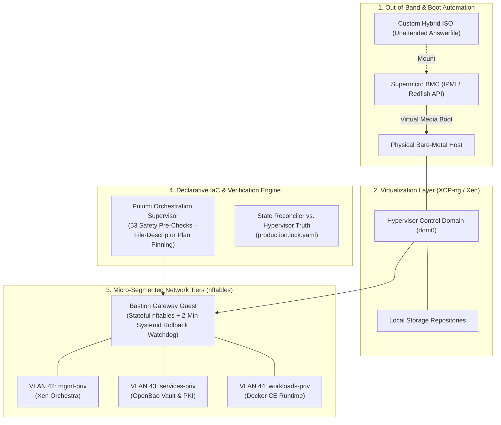

# Gauthier Betaucourt

**Battle-Tested Lead Developer & Systems Software Engineer**  
*High-Throughput Backends (TypeScript / Node.js) · Application Observability (OpenTelemetry) · Systems & Platform Automation*  
📍 Lille, France · [LinkedIn](https://www.linkedin.com/in/gauthier-betaucourt/) · ✉️ [gauthierbetaucourt@gmail.com](mailto:gauthierbetaucourt@gmail.com)

---

### Executive Profile

I am a Senior Software Engineer (**8+ years in production**) focused on **building high-performance backend systems, contract-driven APIs, and observable software architectures**.

My engineering foundation started in **C/C++ and systems programming** (Epitech: writing the OG systems projects from scratch—custom memory allocators like `malloc`, Unix shell interpreters, FTP servers, and x86 assembly). This background provides strong mechanical sympathy for what happens beneath the application layer: runtime memory layouts, event loop scheduling, and network packet flows. Today, my primary production environment is **modern TypeScript (Node.js 22+, Fastify)**, alongside **Go**, **Python**, and **C#**.

My core focus areas:
- **Software-First Craft:** Writing resilient, well-typed, and contract-driven backend services (Zod, Fastify, microservices orchestration).
- **Application Observability:** Integrating telemetry directly into software design (OpenTelemetry, Prometheus Exemplars, Datadog, Grafana) so developers understand their runtime behavior instead of treating APMs as black boxes.
- **Systems & Platform Understanding:** Exploring Linux systems, container runtimes, and Infrastructure-as-Code to ensure software is built with full awareness of its execution environment.
- **Mentorship & Vulgarization:** Helping developer teams adopt observability best practices from day one, and translating complex architectural constraints into clear concepts for product and business stakeholders.

---

## 🔬 Sovereign Platform Lab (Work-In-Progress Infrastructure Case Study)

> **Context:** *Active Self-Hosted R&D & Learning Lab (Private Codebase)*  
> *Objective: An ongoing engineering exploration to master Infrastructure-as-Code (Pulumi), bare-metal automation, and isolated runtimes using exclusively open-source tools to test and benchmark software in sovereign, production-like conditions.*

To deeply understand the execution environments where backend software runs, I am building and maintaining an automated bare-metal lab platform **managed entirely as code and fully reproducible from scratch**:

> ⚙️ **Under Active Development (Sovereign CI and Deployment Engine):**  
> A dedicated CI runner pipeline is being integrated directly into this topology. Designed around continuous state reconciliation against hypervisor ground truth, it executes **offline pre-flight invariant checks** before any remote operations, verifies cryptographic commit receipts (`production.lock.yaml`), and isolates build/test execution within ephemeral containers without third-party SaaS dependencies.

### Key Engineering Patterns Explored in the Lab:
- **Zero Trust on First Use (ZTOFU) Bootstrapping:** Mounting guest disk partitions in `dom0` before their first boot to pre-generate SSH host keys into the orchestrator's `known_hosts`, preventing initial MITM trust-on-first-use vulnerabilities.
- **Anonymous File-Descriptor (`fd 3`) Secret Streaming:** Passing Vault/OpenBao tokens to child CLI processes via inherited file descriptors (`fd 3`), preventing secrets from ever appearing in `/proc/$PID/cmdline` or shell history.
- **Fail-Safe Netfilter Watchdogs:** Testing automated firewall updates against a 2-minute systemd watchdog service (`workloads-firewall-rollback`) that automatically rolls back rulesets if connectivity checks fail.
- **Defensive IaC Supervision:** Wrapping Pulumi with **53 pre-execution invariant checks** and pinning execution plans via open file descriptors to eliminate Time-of-Check to Time-of-Use (TOCTOU) risks.

---

## 🔓 Open-Source Engineering Primitives

While my platform lab remains private, I extract and publish **standalone, zero-dependency tools and reference implementations** solving concrete engineering challenges:

| Repository | Focus Area | The Problem It Solves | Stack & Highlights |
| :--- | :--- | :--- | :--- |
| **[`betaucourt/otel-exemplars-lab`](https://github.com/betaucourt/otel-exemplars-lab)** | **Observability & Wire-Level Networking** | Eliminates APM vendor lock-in with a complete reference architecture linking **Prometheus latency histograms to Tempo distributed traces and Loki logs via OpenMetrics Exemplars**, paired with a custom wire-level OTLP/gRPC Protobuf packet inspector. | `Node.js 22` · `Fastify` · `Go` · `TypeScript` · `OTLP/gRPC` · `Prometheus` · `Tempo` · `Loki` · `Grafana` |
| **[`betaucourt/ts-codegraph`](https://github.com/betaucourt/ts-codegraph)** | **Static Analysis & Contract Governance** | Solves cross-repository schema drift and fragile LLM docgen. Extracts TypeScript AST facts (`ts-morph`) into a **14-table `node:sqlite` + FTS5 store** for sub-millisecond symbol search, cross-repo contract auditing, and deterministic Handlebars documentation with CI drift protection. | `TypeScript 5.8` · `ts-morph` · `node:sqlite` · `FTS5` · `Zod` · `Handlebars` · `VitePress` |
| **[`openbao-agent-guard`](https://github.com/betaucourt/openbao-agent-guard)** | **SecOps & AI Agent Defense** | Prevents AI coding agents and CI runners from leaking credentials into LLM context windows, shell logs, or git commits. Enforces hardened OpenBao (Raft) runtime isolation, **zero-leak SHA-256 fingerprint verification**, and `stdin`-only secret ingestion. | `OpenBao / Vault` · `Raft` · `HCL` · `Bash` · `SHA-256` · `Docker Compose` |

---

## 💼 Production Experience

Backed by **8+ years of production experience** delivering mission-critical backends, calculation engines (100% of national workshop quotes across 11 microservices), and group-wide telemetry standards across enterprise insurance, international automotive retail, and e-commerce.

👉 *Detailed corporate career history and recommendations are on my [LinkedIn](https://www.linkedin.com/in/gauthier-betaucourt/).*

---

## 🛠️ Technical Arsenal

- **Software Engineering & Backends:** TypeScript / Node.js (22+, Fastify, NestJS), Python 3.12 (FastAPI, SQLAlchemy), Go, C# (.NET 3.5 / .NET 5+), C/C++ foundations.
- **Deep Observability & Telemetry:** OpenTelemetry (Collectors, SDKs, Exemplars, Semantic Conventions), Prometheus, Grafana (Tempo, Loki, Grafana SDK), Datadog, Dynatrace, ElasticSearch.
- **Architecture, Contracts & Data:** PostgreSQL, SQLite (`node:sqlite`, FTS5), MSSQL, Oracle SQL, Redis, Zod, JSON Schema, Protobuf / gRPC.
- **Platform, Runtimes & CI/CD:** Linux (Debian, systemd understanding, nftables), Docker CE, OpenBao / Vault, Pulumi (IaC), GitHub Actions, GitLab CI, Jenkins.

---

## 🤝 How I Can Help Your Team

I partner with engineering teams and companies aiming to scale their software quality and observability:
- **Tech Lead & Technical Referent:** Guiding backend squads, establishing architectural guardrails (contract testing, CI gates), and translating complex technical realities into clear concepts for product and business stakeholders.
- **Observability Enablement:** Helping developers instrument code with OpenTelemetry from day one, demystifying telemetry, and setting up correlated metric-trace-log architectures to reduce mean-time-to-resolution (MTTR) and APM bills.
- **Backend Modernization & Contract Auditing:** Taming complex codebases, auditing cross-service contracts via AST tooling, and designing safe, phased modernization paths.

**Working Mode:** Full-time Lead / Senior · Fractional / Advisory · Targeted Missions  
**Mobility:** Full Remote (occasional on-site travel per week/month welcomed) · Based in Lille, France  

📫 **Get in touch:** [LinkedIn](https://www.linkedin.com/in/gauthier-betaucourt/) · [gauthierbetaucourt@gmail.com](mailto:gauthierbetaucourt@gmail.com)
